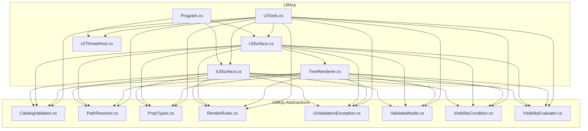

<!-- repo-map:no-verification -->
<!-- GENERATED FILE -- do not edit by hand.
     Regenerate with `repo-tools map`. -->

# @danielsimonjr/ui-mcp - Dependency Graph

**Version**: 0.1.4

This document provides a comprehensive dependency graph of all files, components, imports, functions, and variables in the codebase.

---

## Table of Contents

1. [Overview](#overview)
2. [Package Dependencies](#package-dependencies)
3. [UiMcp Dependencies](#uimcp-dependencies)
4. [UiMcp.Abstractions Dependencies](#uimcp-abstractions-dependencies)
5. [Dependency Matrix](#dependency-matrix)
6. [Circular Dependency Analysis](#circular-dependency-analysis)
7. [Visual Dependency Graph](#visual-dependency-graph)
8. [Summary Statistics](#summary-statistics)

---

## Overview

The codebase is organized into the following modules:

- **UiMcp**: 6 files
- **UiMcp.Abstractions**: 8 files

---

## UiMcp Dependencies

### `src/UiMcp/Hosting/IUiSurface.cs` - IUiSurface.cs module

**Node.js Built-in Dependencies:**
| Module | Import |
|--------|--------|
| `System.Text.Json` | `` |

**Internal Dependencies:**
| File | Imports | Type |
|------|---------|------|
| `UiMcp.Abstractions` | `` | Import |
| `UiMcp.Abstractions` | `` | Import |
| `UiMcp.Abstractions` | `` | Import |
| `UiMcp.Abstractions` | `` | Import |
| `UiMcp.Abstractions` | `` | Import |
| `UiMcp.Abstractions` | `` | Import |
| `UiMcp.Abstractions` | `` | Import |
| `UiMcp.Abstractions` | `` | Import |

**Exports:**

---

### `src/UiMcp/Hosting/UiSurface.cs` - UiSurface.cs module

**Node.js Built-in Dependencies:**
| Module | Import |
|--------|--------|
| `System.Security.Cryptography` | `` |
| `System.Text` | `` |
| `System.Text.Json` | `` |
| `System.Windows` | `` |
| `System.Windows.Controls` | `` |
| `System.Windows.Media` | `` |

**Internal Dependencies:**
| File | Imports | Type |
|------|---------|------|
| `UiMcp.Abstractions` | `` | Import |
| `UiMcp.Abstractions` | `` | Import |
| `UiMcp.Abstractions` | `` | Import |
| `UiMcp.Abstractions` | `` | Import |
| `UiMcp.Abstractions` | `` | Import |
| `UiMcp.Abstractions` | `` | Import |
| `UiMcp.Abstractions` | `` | Import |
| `UiMcp.Abstractions` | `` | Import |
| `UiMcp.Rendering` | `` | Import |

**Exports:**

---

### `src/UiMcp/Hosting/UiThreadHost.cs` - UiThreadHost.cs module

**Node.js Built-in Dependencies:**
| Module | Import |
|--------|--------|
| `System.Windows.Threading` | `` |

**Exports:**

---

### `src/UiMcp/Program.cs` - Program.cs module

**External Dependencies:**
| Package | Import |
|---------|--------|
| `Microsoft.Extensions.DependencyInjection` | `` |
| `Microsoft.Extensions.Hosting` | `` |
| `Microsoft.Extensions.Logging` | `` |
| `ModelContextProtocol.Server` | `` |

**Internal Dependencies:**
| File | Imports | Type |
|------|---------|------|
| `UiMcp.Hosting` | `` | Import |
| `UiMcp.Hosting` | `` | Import |
| `UiMcp.Hosting` | `` | Import |

---

### `src/UiMcp/Rendering/TreeRenderer.cs` - TreeRenderer.cs module

**Node.js Built-in Dependencies:**
| Module | Import |
|--------|--------|
| `System.Text.Json` | `` |
| `System.Windows` | `` |
| `System.Windows.Controls` | `` |
| `System.Windows.Controls.Primitives` | `` |
| `System.Windows.Media` | `` |

**Internal Dependencies:**
| File | Imports | Type |
|------|---------|------|
| `UiMcp.Abstractions` | `` | Import |
| `UiMcp.Abstractions` | `` | Import |
| `UiMcp.Abstractions` | `` | Import |
| `UiMcp.Abstractions` | `` | Import |
| `UiMcp.Abstractions` | `` | Import |
| `UiMcp.Abstractions` | `` | Import |
| `UiMcp.Abstractions` | `` | Import |
| `UiMcp.Abstractions` | `` | Import |

**Exports:**

---

### `src/UiMcp/Tools/UiTools.cs` - UiTools.cs module

**External Dependencies:**
| Package | Import |
|---------|--------|
| `ModelContextProtocol.Server` | `` |

**Node.js Built-in Dependencies:**
| Module | Import |
|--------|--------|
| `System.ComponentModel` | `` |
| `System.Security.Cryptography` | `` |
| `System.Text` | `` |
| `System.Text.Json` | `` |

**Internal Dependencies:**
| File | Imports | Type |
|------|---------|------|
| `UiMcp.Abstractions` | `` | Import |
| `UiMcp.Abstractions` | `` | Import |
| `UiMcp.Abstractions` | `` | Import |
| `UiMcp.Abstractions` | `` | Import |
| `UiMcp.Abstractions` | `` | Import |
| `UiMcp.Abstractions` | `` | Import |
| `UiMcp.Abstractions` | `` | Import |
| `UiMcp.Abstractions` | `` | Import |
| `UiMcp.Hosting` | `` | Import |
| `UiMcp.Hosting` | `` | Import |
| `UiMcp.Hosting` | `` | Import |

**Exports:**

---

## UiMcp.Abstractions Dependencies

### `src/UiMcp.Abstractions/CatalogValidator.cs` - CatalogValidator.cs module

**Node.js Built-in Dependencies:**
| Module | Import |
|--------|--------|
| `System.Text.Json` | `` |

**Exports:**

---

### `src/UiMcp.Abstractions/PathResolver.cs` - PathResolver.cs module

**Node.js Built-in Dependencies:**
| Module | Import |
|--------|--------|
| `System.Globalization` | `` |
| `System.Text.Json` | `` |
| `System.Text.RegularExpressions` | `` |

**Exports:**

---

### `src/UiMcp.Abstractions/PropTypes.cs` - PropTypes.cs module

**Node.js Built-in Dependencies:**
| Module | Import |
|--------|--------|
| `System.Text.Json` | `` |
| `System.Text.RegularExpressions` | `` |

**Exports:**

---

### `src/UiMcp.Abstractions/RenderRules.cs` - RenderRules.cs module

**Node.js Built-in Dependencies:**
| Module | Import |
|--------|--------|
| `System.Globalization` | `` |
| `System.Text.Json` | `` |

**Exports:**

---

### `src/UiMcp.Abstractions/UiValidationException.cs` - UiValidationException.cs module

**Exports:**

---

### `src/UiMcp.Abstractions/ValidatedNode.cs` - ValidatedNode.cs module

**Exports:**

---

### `src/UiMcp.Abstractions/VisibilityCondition.cs` - VisibilityCondition.cs module

**Node.js Built-in Dependencies:**
| Module | Import |
|--------|--------|
| `System.Text.Json` | `` |

**Exports:**

---

### `src/UiMcp.Abstractions/VisibilityEvaluator.cs` - VisibilityEvaluator.cs module

**Node.js Built-in Dependencies:**
| Module | Import |
|--------|--------|
| `System.Globalization` | `` |
| `System.Text.Json` | `` |

**Exports:**

---

## Dependency Matrix

### File Import/Export Matrix

| File | Imports From | Exports To |
|------|--------------|------------|
| `src/UiMcp/Hosting/UiSurface.cs` | 2 files | 2 files |
| `src/UiMcp.Abstractions/CatalogValidator.cs` | 0 files | 4 files |
| `src/UiMcp.Abstractions/PathResolver.cs` | 0 files | 4 files |
| `src/UiMcp.Abstractions/PropTypes.cs` | 0 files | 4 files |
| `src/UiMcp.Abstractions/RenderRules.cs` | 0 files | 4 files |
| `src/UiMcp.Abstractions/UiValidationException.cs` | 0 files | 4 files |
| `src/UiMcp.Abstractions/ValidatedNode.cs` | 0 files | 4 files |
| `src/UiMcp.Abstractions/VisibilityCondition.cs` | 0 files | 4 files |
| `src/UiMcp.Abstractions/VisibilityEvaluator.cs` | 0 files | 4 files |
| `src/UiMcp/Hosting/IUiSurface.cs` | 1 file | 2 files |
| `src/UiMcp/Hosting/UiThreadHost.cs` | 0 files | 2 files |
| `src/UiMcp/Rendering/TreeRenderer.cs` | 1 file | 1 file |
| `src/UiMcp/Tools/UiTools.cs` | 2 files | 0 files |
| `src/UiMcp/Program.cs` | 1 file | 0 files |

---

## Circular Dependency Analysis

**No circular dependencies detected.**
---

## Visual Dependency Graph

---

## Summary Statistics

| Category | Count |
|----------|-------|
| Total Source Files | 25 |
| Subsystems | 2 |
| Total Lines of Code | 4676 |
| Total Exports | 42 |
| Type-only Imports | 0 |
| Runtime Cyclic Components | 0 |
| Type-only Cyclic Components | 0 |
| Files in Runtime Cycles | 0 |
| Files in Type-only Cycles | 0 |

---

*Version*: 0.1.4
